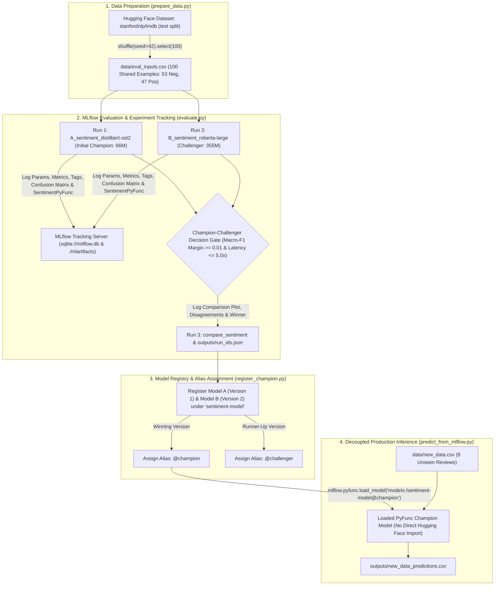

# MLOps Experiment Tracking, Model Registry, and Deployment Workflow

* **Student Name:** mdyusuf
* **Student USN:** `1MS26CI405`
* **Project:** Champion–Challenger Model Comparison with Hugging Face and MLflow
* **MLflow Experiment:** `hf-sentiment-champion-challenger`
* **Registered Model Name:** `sentiment-model`

## 1. End-to-End MLOps Workflow Diagram

The diagrams below illustrate how data preparation, experiment evaluation, the Champion–Challenger promotion gate, the [MLflow Model Registry](https://mlflow.org/docs/latest/ml/model-registry/), and alias-decoupled batch inference connect across our five Python scripts.



### Text-Based Pipeline Architecture Flow

```text
[stanfordnlp/imdb (test)]
          │
          ▼  (prepare_data.py | SEED=42)
[data/eval_inputs.csv (100 samples)]
          │
          ├───────────────────────────────────────────┐
          ▼                                           ▼
[Model A: DistilBERT-SST2 (66M)]            [Model B: SiEBERT RoBERTa-Large (355M)]
Run: A_sentiment_distilbert-sst2            Run: B_sentiment_roberta-large
  • Logs 8 params, 7 metrics, 4 tags          • Logs 8 params, 7 metrics, 4 tags
  • Logs predictions, JSON, confusion PNG     • Logs predictions, JSON, confusion PNG
  • Logs custom SentimentPyFunc model         • Logs custom SentimentPyFunc model
          │                                           │
          └───────────────────┬───────────────────────┘
                              ▼  (evaluate.py Decision Rule)
             [Champion–Challenger Gate & compare_sentiment Run]
               • Primary Metric: macro_f1 (margin >= 0.01)
               • Guardrail: latency_B <= 5.0 * latency_A
               • Tie-Breaker (|delta| < 0.01): faster model wins
               • Outputs: run_ids.json, metrics_summary.json,
                          model_comparison.png, disagreements.csv
                              │
                              ▼  (register_champion.py)
               [MLflow Model Registry: "sentiment-model"]
               • Registers Version 1 (runs:/<run_a>/model)
               • Registers Version 2 (runs:/<run_b>/model)
               • Winning Version   ──► Alias: @champion
               • Other Version     ──► Alias: @challenger
                              │
                              ▼  (predict_from_mlflow.py)
            [Production Inference via Alias URI]
               • Loads: models:/sentiment-model@champion
               • Uses: mlflow.pyfunc.load_model()
               • Scores: data/new_data.csv (8 unseen reviews)
               • Saves: outputs/new_data_predictions.csv
```

## 2. Experiment Tracking Using MLflow

To support both experiment tracking and the [MLflow Model Registry](https://mlflow.org/docs/latest/ml/model-registry/workflow/), the project runs a local MLflow tracking server backed by a relational SQLite database (`sqlite:///mlflow.db`) for metadata and a local directory (`./mlartifacts`) for model weights, plots, and CSV/JSON artifacts:

```powershell
mlflow server --backend-store-uri sqlite:///mlflow.db --default-artifact-root ./mlartifacts --host 127.0.0.1 --port 5000
```

When `evaluate.py` runs, it connects to `http://127.0.0.1:5000` and organizes all tracking data under the experiment **`hf-sentiment-champion-challenger`** via three distinct runs:

| MLflow Run Name | Candidate Role | Logged Parameters | Logged Metrics | Logged Tags | Logged Artifacts & Models |
| :--- | :--- | :--- | :--- | :--- | :--- |
| **`A_sentiment_distilbert-sst2`** | `champion_candidate` ([DistilBERT 66M](https://huggingface.co/distilbert/distilbert-base-uncased-finetuned-sst-2-english)) | `hf_model_id`, `task`, `role`, `batch_size=8`, `eval_samples=100`, `seed=42`, `device=cpu`, `max_length=512` | `accuracy`, `precision`, `recall`, `f1`, `macro_f1`, `avg_latency_ms`, `total_inference_s` | `student_name=mdyusuf`, `student_usn=1MS26CI405`, `dataset_name=IMDB`, `library_versions` | `eval_inputs.csv`, `predictions_champion_candidate.csv`, `metrics_champion_candidate.json`, `confusion_matrix_champion_candidate.png`, plus [`mlflow.pyfunc`](https://mlflow.org/docs/latest/api_reference/python_api/mlflow.pyfunc.html) `model/` |
| **`B_sentiment_roberta-large`** | `challenger_candidate` ([SiEBERT 355M](https://huggingface.co/siebert/sentiment-roberta-large-english)) | `hf_model_id`, `task`, `role`, `batch_size=8`, `eval_samples=100`, `seed=42`, `device=cpu`, `max_length=512` | `accuracy`, `precision`, `recall`, `f1`, `macro_f1`, `avg_latency_ms`, `total_inference_s` | `student_name=mdyusuf`, `student_usn=1MS26CI405`, `dataset_name=IMDB`, `library_versions` | `eval_inputs.csv`, `predictions_challenger_candidate.csv`, `metrics_challenger_candidate.json`, `confusion_matrix_challenger_candidate.png`, plus [`mlflow.pyfunc`](https://mlflow.org/docs/latest/api_reference/python_api/mlflow.pyfunc.html) `model/` |
| **`compare_sentiment`** | Summary & Decision Audit Run | `primary_metric=macro_f1`, `margin=0.01`, `latency_guardrail=5.0` | `delta_primary_metric`, `model_a_macro_f1`, `model_b_macro_f1`, `model_a_avg_latency_ms`, `model_b_avg_latency_ms`, `total_disagreements` | `student_name=mdyusuf`, `student_usn=1MS26CI405`, `winner`, `decision_rule` | `model_comparison.png`, `metrics_summary.json`, `disagreements.csv`, `disagreements_qualitative.json`, `README.md`, `requirements.txt` |

### Custom `SentimentPyFunc` Packaging

Instead of saving raw PyTorch tensors that require manual tokenization downstream, `evaluate.py` subclasses [`mlflow.pyfunc.PythonModel`](https://mlflow.org/docs/latest/api_reference/python_api/mlflow.pyfunc.html) to define `SentimentPyFunc(model_id)`:
* **`load_context(self, context)`:** Reconstructs the Hugging Face `pipeline("sentiment-analysis", model=self.model_id, tokenizer=self.model_id, device=-1)` automatically whenever MLflow loads the model.
* **`predict(self, context, model_input, params=None)`:** Accepts a standardized `pandas.DataFrame` containing a `"text"` column, runs batched inference (`batch_size=8, truncation=True, max_length=512`), normalizes label strings (`LABEL_1`/`POSITIVE` → `"POSITIVE"`, `LABEL_0`/`NEGATIVE` → `"NEGATIVE"`), and returns a `pandas.DataFrame` with columns `["text", "prediction", "score"]` enforced by [`mlflow.models.infer_signature()`](https://mlflow.org/docs/latest/ml/model/).

## 3. Champion–Challenger Evaluation Workflow

The Champion–Challenger methodology is an industry-standard MLOps validation pattern in which the currently trusted production model (**Champion**) is benchmarked head-to-head against a newly proposed candidate (**Challenger**) under controlled, identical conditions before any deployment promotion occurs:

1. **Identical Shared Input Guarantee:** Both models read the exact same 100 rows from `data/eval_inputs.csv` (sampled from [`stanfordnlp/imdb`](https://huggingface.co/datasets/stanfordnlp/imdb) with `SEED = 42`). Evaluating on identical texts and row order eliminates sampling variance between runs.
2. **High-Resolution Latency Timing:** Inside `evaluate_model()`, wall-clock inference duration is measured strictly around the `classifier(texts, batch_size=8, truncation=True, max_length=512)` call using Python's `time.perf_counter()`, yielding both `total_inference_s` and per-review `avg_latency_ms = (total_time / 100) * 1000`.
3. **Automated Promotion Gate:** Once both candidate runs complete, `evaluate.py` computes `delta = score_b - score_a` (where `score` is [`macro_f1`](https://scikit-learn.org/stable/modules/generated/sklearn.metrics.f1_score.html)) and evaluates three mutually exclusive branches:
   * **Branch 1 — Equivalence Tie-Breaker (`abs(delta) < 0.01`):** When the Macro-F1 difference is less than `0.01` (`1%`), the models are statistically indistinguishable on 100 examples, so the faster model (`latency_a <= latency_b` → `model_A`, else `model_B`) wins.
   * **Branch 2 — Challenger Promotion (`delta >= 0.01` and `latency_b <= 5.0 * latency_a`):** When Model B improves Macro-F1 by at least `0.01` *and* keeps its average latency within `5.0x` of Model A, `winner = "model_B"`.
   * **Branch 3 — Champion Retention (`else`):** If Model B performs worse or breaches the `5.0x` latency guardrail, `winner = "model_A"`.
4. **Handoff Artifact (`outputs/run_ids.json`):** `evaluate.py` writes the run IDs (`model_a_run_id`, `model_b_run_id`, `summary_run_id`), `winner`, and `registered_model_name` (`"sentiment-model"`) to `outputs/run_ids.json` for downstream registration.

## 4. Model Registration Process

In Stage 9, `register_champion.py` automates model registration in the [MLflow Model Registry](https://mlflow.org/docs/latest/ml/model-registry/workflow/):

1. **Reading Run Provenance:** The script reads `outputs/run_ids.json` to retrieve `run_a`, `run_b`, and `winner`.
2. **Unified Model Registration:** Both models solve the same business task (binary sentiment classification), so both are registered as sequential versions under a single registered model entity named **`sentiment-model`** using [`mlflow.register_model()`](https://mlflow.org/docs/latest/api_reference/python_api/mlflow.models.html):
   * **Version 1:** `mlflow.register_model(model_uri=f"runs:/{run_a}/model", name="sentiment-model")` (Model A — DistilBERT).
   * **Version 2:** `mlflow.register_model(model_uri=f"runs:/{run_b}/model", name="sentiment-model")` (Model B — SiEBERT RoBERTa-Large).
3. **Traceability:** Each registered version retains an immutable link back to its originating experiment run ID, parameters, metrics, model signature, and confusion matrix artifact in the MLflow UI.

## 5. How the `@champion` and `@challenger` Aliases Work

In modern [MLflow Model Registry workflows](https://mlflow.org/docs/latest/ml/model-registry/workflow/) (which replaced deprecated fixed stages like `"Staging"` and `"Production"`), **Model Aliases** are mutable, human-readable pointers (`@alias_name`) assigned to specific immutable version numbers of a registered model:

1. **Programmatic Alias Assignment:** Using [`MlflowClient.set_registered_model_alias()`](https://mlflow.org/docs/latest/api_reference/python_api/mlflow.client.html), `register_champion.py` maps the evaluation winner to `@champion` and the runner-up to `@challenger`:
   ```python
   client.set_registered_model_alias(
       name="sentiment-model",
       alias="champion",
       version=champion_version
   )
   client.set_registered_model_alias(
       name="sentiment-model",
       alias="challenger",
       version=challenger_version
   )
   ```
2. **Decoupling Code from Version Numbers:** Downstream inference services never hardcode `models:/sentiment-model/1` or `models:/sentiment-model/2`, nor do they hardcode Hugging Face model IDs. Instead, they always request **`models:/sentiment-model@champion`**.
3. **Zero-Downtime Promotion and Instant Rollback:** If a future Challenger (Version 3) wins a later evaluation, reassigning the `@champion` alias from Version 2 to Version 3 immediately routes production inference to the new model without changing a single line of code in `predict_from_mlflow.py`. Conversely, if an issue is detected in production, pointing `@champion` back to the previous version performs an instant rollback.

## 6. Generating Predictions Using the Registered Model

In Stage 10, `predict_from_mlflow.py` demonstrates production model consumption by scoring `8` unseen movie reviews from `data/new_data.csv` strictly through MLflow:

1. **Zero Direct Hugging Face Imports:** `predict_from_mlflow.py` imports only `mlflow`, `pandas`, and `MlflowClient`. It contains **no** `from transformers import pipeline` statement.
2. **Dynamic Metadata Lookup via Alias:** Using [`client.get_model_version_by_alias("sentiment-model", "champion")`](https://mlflow.org/docs/latest/api_reference/python_api/mlflow.client.html), the script resolves which version number currently holds the `@champion` alias, looks up its source `run_id`, and fetches the logged `hf_model_id` parameter from the tracking server for audit logging.
3. **Loading the PyFunc Model by Alias URI:** The script loads the packaged `SentimentPyFunc` model directly from the registry:
   ```python
   MODEL_URI = "models:/sentiment-model@champion"
   champion_model = mlflow.pyfunc.load_model(MODEL_URI)
   ```
4. **Batch Inference and Output Audit Trail:** Calling `champion_model.predict(new_data[["text"]])` invokes the custom `SentimentPyFunc.predict()` method under the hood, returning binary `"POSITIVE"` / `"NEGATIVE"` labels and confidence scores. The script appends `model_version`, `hf_model_id`, and `student_usn` (`1MS26CI405`) to the DataFrame and saves the final output to `outputs/new_data_predictions.csv`.

## 7. Git Commit Command for This Deliverable

After placing `MLOPS_WORKFLOW.md` in the root of your `1MS26CI405-mlflow-champion-challenger` project folder, stage and commit it in the PyCharm Terminal:

```bash
git add MLOPS_WORKFLOW.md
git commit -m "docs: document mlops experiment and deployment workflow"
```
